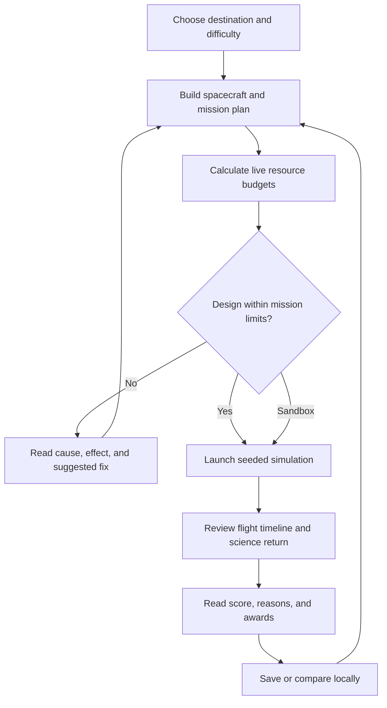
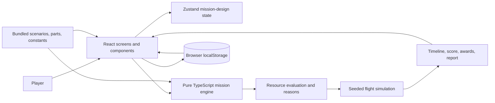

<div align="center">

# Galaxy Run

**Design a space mission. Launch it. Find out why it worked or failed.**

A browser game about balancing spacecraft choices and learning from their consequences.

[How it works](#how-it-works) · [Architecture](docs/ARCHITECTURE.md) · [Run locally](#run-locally) · [Contributing](CONTRIBUTING.md)

</div>

> **Project deadline: December 15, 2026.** Hackathon kickoff scheduling is intentionally not part of this plan. Human testing and external submission steps are tracked in the development checklist.

## The idea

Galaxy Run turns early mission design into a short, replayable systems exercise. Pick a destination, assemble a spacecraft, trade science against resources, fly a repeatable simulation, and learn from the result.

The **why engine** makes the trade-offs visible. Every design check reports its status, cause, effect, and a possible fix. This is an educational game, not a spacecraft engineering tool.

## How it works

1. Choose an Earth, Moon, Mars, or Venus mission and a difficulty, or use Sandbox.
2. Select a spacecraft bus, three to five instruments, propulsion, propellant, launcher, orbit, solar-panel area, and mission schedule.
3. Review live mass, power, eclipse energy, cost, data, science, reliability, thermal risk, delta-v, and schedule estimates.
4. Fly with a seed, then inspect the timeline, score, explanation, and awards. The same design and seed reproduce the same events.
5. Revise, save, compare, and replay designs on the same device.



## Features

- Four destination scenarios; Easy, Normal, Hard, and resource-unbounded Sandbox modes.
- A catalog of spacecraft buses, instruments, launch vehicles, propulsion systems, and orbit options.
- Live mass, power, eclipse battery, budget, data, science, reliability, thermal, delta-v, and schedule checks.
- Cause/effect/fix explanations and repeatable seeded flight events.
- Local design saving and comparison, NASA mission field notes, interactive orbit/spacecraft views, and a print-to-PDF flight report.
- Original project artwork and optional synthesized sound, first-flight guidance, contextual definitions, keyboard support, and reduced-motion handling.

## Architecture at a glance



The core game runs in the browser from bundled data. There is no runtime AI model, remote game backend, or account service in the current code. The pilot name, saved designs, and first-flight guide status are kept in browser storage; current mission state and flight results are in memory. See [the full architecture and data notes](docs/ARCHITECTURE.md).

## Team

- Kiran Shams
- Hadeed Ahsan
- Rimsha Younis
- Mariam

## AI tools

AI tools are used as part of project development, not as models called by the game. The team has identified Claude and Google Antigravity; the repository also records OpenAI Codex. Antigravity is a development environment, and its selected underlying model is not recorded here. See [docs/AI_USE.md](docs/AI_USE.md) for the working attribution record and review status.

## Data, assumptions, and credits

Planetary radii, gravitational parameters, and solar irradiance values are bundled from NASA/JPL and NASA NSSDC references. NASA mission and instrument information is included as learning material. Costs, spacecraft masses, efficiencies, reliability, risk, launch capacity, and event probabilities are simplified game assumptions. Source links, retrieval dates, libraries, and original assets are listed in [docs/CREDITS.md](docs/CREDITS.md).

## Live deployment

The project team reports that a Vercel deployment exists, but its production URL is not recorded in this repository. Add and verify the URL before sharing the README or submitting the project.

## Run locally

You need Node.js 20 or newer and Git.

```bash
git clone https://github.com/kiranShamsHere/galaxyrun.git
cd galaxyrun
npm install
npm run dev
```

Open the local address printed by Vite, usually `http://localhost:5173`.

| Command | Purpose |
| --- | --- |
| `npm run dev` | Start the development server |
| `npm run check` | Run lint, typecheck, tests, and a production build |
| `npm run test` | Run formula and engine tests |
| `npm run build` | Typecheck and build for production |
| `npm run preview` | Preview the production build locally |

## Project structure

```text
src/
  components/  Landing page, designer, 3D views, field notes, report panels
  data/        Mission scenarios, spacecraft catalog, NASA references, glossary
  engine/      Pure calculations, design evaluation, seeded simulation, tests
  learn/       Learning notes and worked examples
  ui/          UI-layer responsibilities
  utils/       Browser-local design and guide storage, sound effects
  App.tsx      Main screens and mission interactions
  store.ts     In-memory mission design state
public/assets/ Original SVG artwork and launch sound
docs/          Architecture, credits, AI use, checklists
.github/       CI workflow and pull-request template
```

For the complete file tree and component responsibilities, see [docs/ARCHITECTURE.md](docs/ARCHITECTURE.md).

## Verification and handoff

Run `npm run check` before proposing a change. Human playtesting, accessibility reviews, deployment-link verification, team review, and event-site fields remain tracked in [docs/DEVELOPMENT_CHECKLIST.md](docs/DEVELOPMENT_CHECKLIST.md) and [docs/SUBMISSION_CHECKLIST.md](docs/SUBMISSION_CHECKLIST.md).

## License

[MIT](LICENSE)
