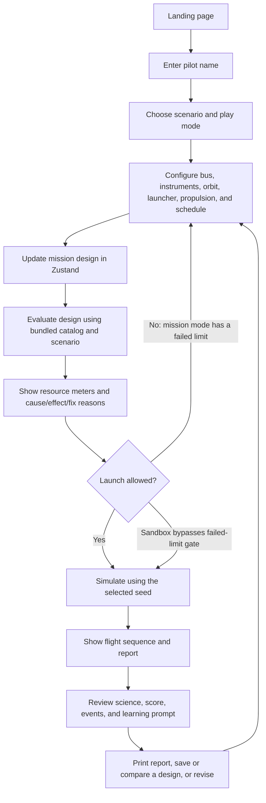
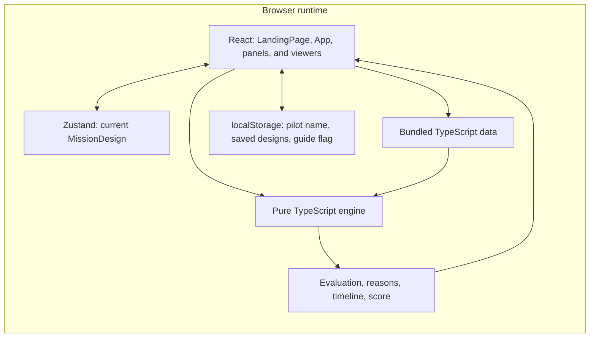

# Galaxy Run architecture

This document describes the current implementation in the repository. Galaxy Run is a client-side educational game: its mission calculations use bundled TypeScript data and run in the browser. It is not a flight-design system or a production spacecraft simulator.

## Mission lifecycle



In mission mode, any failed design reason holds the launch. Sandbox still reports limits but does not use a failed limit to block the flight. Design evaluation is recalculated from the current design; a flight report represents the result of that one seeded simulation.

## Runtime layers and data flow



- **UI:** `src/App.tsx` composes mission setup, live telemetry, flight sequence, and report. Components in `src/components/` handle focused parts of the experience, such as the landing page, saved-design library, NASA mission hub, orbit views, spacecraft view, and player-name screen.
- **State:** `src/store.ts` keeps the active mission design in Zustand memory. It is not configured for persisted Zustand state.
- **Static data:** `src/data/` supplies scenarios, orbit options, parts, launch vehicles, propulsion systems, physical constants, mission-reference content, and glossary text.
- **Engine:** `src/engine/` has no React or browser APIs. It evaluates a design, calculates orbit/power values, simulates a seeded flight, and returns typed results and explanations.
- **Persistence:** `src/utils/designLibrary.ts` validates saved designs with Zod and stores them locally. `src/utils/guideStorage.ts` stores whether the first-flight guide was completed. The pilot name is stored by `src/App.tsx`. Browser storage may be unavailable or cleared by the user.

The current code has no Supabase integration, remote game service, account system, analytics integration, or runtime AI API. Mission calculations use local bundled values and run in the browser. External links in learning content take the player to their cited sources.

## What data the game uses

| Data | Contents and use | Origin |
| --- | --- | --- |
| Mission scenarios | Earth, Moon, Mars, and Venus objectives, budgets, deadlines, irradiance, downlink rates, environmental factors, and orbit choices | `src/data/catalog.ts`; simplified scenario design, with physical inputs sourced separately |
| Spacecraft catalog | Bus and instrument mass, power, cost, data rate, science value, reliability, thermal tolerance, and bus battery capacity | `src/data/catalog.ts`; fictional educational game values |
| Launch and propulsion | Per-destination launcher payload/cost, propulsion dry mass, propellant limit, specific impulse, power, cost, reliability, and thermal tolerance | `src/data/catalog.ts`; simplified game assumptions |
| Physical constants | Mean body radii and gravitational parameters for Earth, Moon, Mars, and Venus | NASA/JPL links and retrieval date are recorded in `src/data/missionConstants.ts` and `docs/CREDITS.md` |
| Solar irradiance | Earth/Moon, Mars, and Venus scenario inputs | NASA NSSDC fact sheets; source links and values are recorded in `src/data/catalog.ts` and `docs/CREDITS.md` |
| Mission-learning content | NASA mission, instrument, mission-design, and systems-engineering notes, with source links in the content where provided | `src/data/nasaMissionData.ts`, `src/components/MissionLearningCards.tsx`, and `docs/CREDITS.md` |
| Player-created information | Pilot display name, saved design name/configuration, and first-flight guide completion flag | Browser `localStorage` on that device; not sent to a project backend |
| Flight result | Seed, events, timeline, returned data, science, reasons, and score | Calculated in memory by the local engine; not submitted to a leaderboard or server |

The game does not ingest live NASA telemetry or fetch physical data for calculations. Its catalog values are deliberately simplified and must not be used for real mission planning. Refer to [the credits register](CREDITS.md) for cited source URLs, dates, assets, and dependencies.

## Evaluation and simulation

`evaluateDesign` combines a `MissionDesign`, its scenario, catalog parts, launch vehicles, and propulsion systems to produce a `DesignEvaluation`. It checks:

- total mass against orbit-adjusted launcher capacity;
- instrument/system power against solar-array output, and eclipse energy against bus battery capacity;
- cost against the difficulty-adjusted scenario budget;
- estimated ideal rocket-equation delta-v against the scenario target;
- instrument data generation against estimated downlink capacity;
- development plus mission duration against the scenario deadline;
- simplified thermal exposure and component reliability.

Orbit period, ideal rocket-equation delta-v, solar power, eclipse energy, and downlink capacity are implemented in `src/engine/orbit.ts` and `src/engine/power.ts`. Every displayed design reason has a status and a cause, effect, and suggested fix. The game uses simplified assumptions: for example, it does not model a detailed transfer trajectory, real thrust duration, gravity losses, or a full spacecraft thermal design.

`simulateMission` first evaluates the design, then uses a seeded pseudo-random generator to select repeatable events such as launch delays, solar flares, instrument faults, communications interruptions, and system anomalies. It derives returned data and science, builds a flight timeline, and scores science return, efficiency, reliability, and learning. The score weights are 35%, 25%, 25%, and 15%, respectively. The same design, scenario, and seed produce the same event sequence. Sandbox runs bypass the design-failure launch gate; they are practice, not evidence that an over-limit design is feasible.

The engine tests in `src/engine/engine.test.ts` check the calculations, expected educational examples, and seeded repeatability. `src/toolchain.test.ts` exercises the application toolchain and state store.

## Browser storage and privacy boundaries

- Pilot name: `galaxy-run-pilot-name` in browser `localStorage`.
- Saved designs: `galaxy-run:saved-designs` in browser `localStorage`; design data is schema-validated before saving and loading.
- First-flight guide: `galaxy-run:first-flight-guide` in browser `localStorage`.
- Active design, evaluation, and flight report: held in application memory.

These values are device/browser-local. Clearing site data removes them; opening the game on another device does not transfer them. Do not enter sensitive personal information as a pilot name.

## AI use

The game does not call Claude, Antigravity, Codex, or any other AI service at runtime. The team reports using Claude and Google Antigravity during development; the repository also records OpenAI Codex. Google Antigravity is a development environment, not itself a model name. Its selected underlying model and each tool's exact file-level contribution have not been independently recorded, so the team should verify attribution in [docs/AI_USE.md](AI_USE.md) before submission.

## Full repository structure

```text
.
├── .github/
│   ├── PULL_REQUEST_TEMPLATE.md
│   └── workflows/ci.yml
├── .editorconfig
├── .gitignore
├── .nvmrc
├── .oxlintrc.json
├── .vscode/
│   └── extensions.json
├── CONTRIBUTING.md
├── docs/
│   ├── ARCHITECTURE.md
│   ├── AI_USE.md
│   ├── CREDITS.md
│   ├── DEVELOPMENT_CHECKLIST.md
│   ├── SUBMISSION_CHECKLIST.md
│   └── screenshots/.gitkeep
├── index.html
├── LICENSE
├── public/
│   ├── assets/                 # Original illustrations, emblems, and launch cue
│   ├── favicon.svg
│   └── robots.txt
├── src/
│   ├── components/
│   │   ├── DesignLibraryPanel.tsx
│   │   ├── FirstMissionGuide.tsx
│   │   ├── HowToPlaySection.tsx
│   │   ├── LandingHero3D.tsx
│   │   ├── LandingPage.tsx
│   │   ├── MissionLearningCards.tsx
│   │   ├── NasaMissionHubModal.tsx
│   │   ├── Orbit3DViewer.tsx
│   │   ├── OrbitDiagram.tsx
│   │   ├── PlanetComparator.tsx
│   │   ├── PlayerNamePage.tsx
│   │   ├── SpaceIcon.tsx
│   │   ├── Spacecraft3DViewer.tsx
│   │   └── TermTip.tsx
│   ├── data/
│   │   ├── README.md
│   │   ├── catalog.ts
│   │   ├── glossary.ts
│   │   ├── missionConstants.ts
│   │   └── nasaMissionData.ts
│   ├── engine/
│   │   ├── README.md
│   │   ├── engine.test.ts
│   │   ├── evaluateDesign.ts
│   │   ├── orbit.ts
│   │   ├── power.ts
│   │   ├── simulateMission.ts
│   │   └── types.ts
│   ├── learn/
│   │   ├── README.md
│   │   └── fuel.md
│   ├── ui/README.md
│   ├── utils/
│   │   ├── designLibrary.ts
│   │   ├── guideStorage.ts
│   │   └── soundEffects.ts
│   ├── App.tsx
│   ├── index.css
│   ├── main.tsx
│   ├── store.ts
│   └── toolchain.test.ts
├── package-lock.json
├── package.json
├── README.md
├── tsconfig.app.json
├── tsconfig.json
├── tsconfig.node.json
└── vite.config.ts
```

### Source file map

```text
src/components/
  DesignLibraryPanel.tsx   Saved design library panel
  FirstMissionGuide.tsx    First-flight walkthrough
  HowToPlaySection.tsx     Instructions and gameplay help
  LandingHero3D.tsx        Three.js landing-page scene
  LandingPage.tsx          Entry screen and scenario overview
  MissionLearningCards.tsx NASA mission learning cards
  NasaMissionHubModal.tsx  Mission and design reference modal
  Orbit3DViewer.tsx        Three.js orbit visualization
  OrbitDiagram.tsx         2D orbit visualization
  PlayerNamePage.tsx       Local pilot-name entry
  PlanetComparator.tsx     Planet comparison view
  SpaceIcon.tsx            Shared icon helper
  Spacecraft3DViewer.tsx   Three.js spacecraft visualization
  TermTip.tsx              Contextual glossary help
src/data/
  catalog.ts               Scenarios, spacecraft parts, launchers, propulsion
  glossary.ts              In-game terms
  missionConstants.ts      NASA/JPL planetary constants and source links
  nasaMissionData.ts       Mission heritage and mission-design reference data
src/engine/
  engine.test.ts           Calculation and repeatability tests
  evaluateDesign.ts        Design resource checks and explanations
  orbit.ts                 Orbit, delta-v, and downlink calculations
  power.ts                 Solar and eclipse calculations
  simulateMission.ts       Seeded flight events, timeline, score, and report data
  types.ts                 Engine input and output types
src/utils/
  designLibrary.ts         Validated browser-local design saves
  guideStorage.ts          Browser-local guide completion flag
  soundEffects.ts          Optional Web Audio API sound effects
```

## Technology

- React and TypeScript for the browser UI and typed domain data.
- Vite for development and production builds.
- Three.js for interactive visual scenes.
- Zustand for in-memory mission-design state.
- Zod for validating saved design data.
- Vitest and Oxlint for tests and linting.

Dependency versions and scripts are defined in `package.json`; NASA sources, software licenses, and project-created assets are in `docs/CREDITS.md`.
